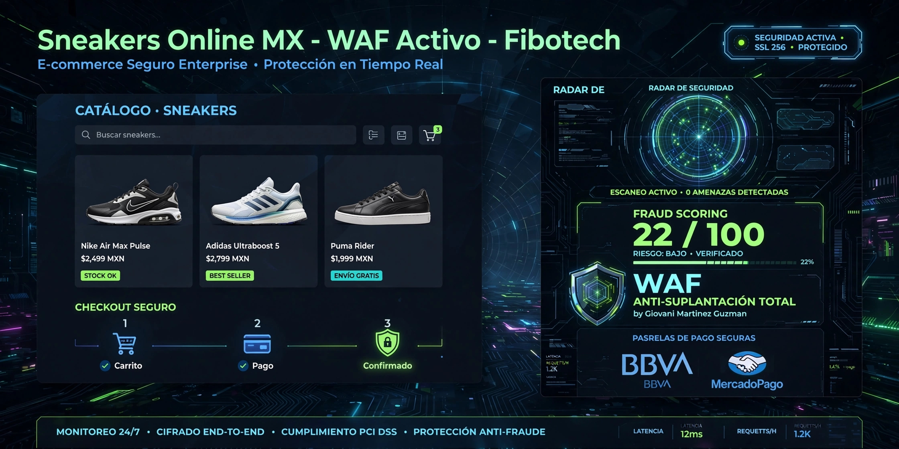

# Sneakers Online MX - E-commerce Seguro Enterprise



**Autor: Giovani Martinez Guzman | Ecatepec, MX | Fibotech CON ANTI-SUPLANTACIÓN TOTAL

E-commerce de sneakers sin peticiones de credenciales ni inicio de seción todo por Whatsapp personal del propietario precios y modos de pedido

### 🚀 Qué lo hace PRO
- **WAF Defensivo:** Detecta faceb00k, xn--, bbva.mx@phishing
- **Checkout Seguro:** nombre ubicación modo de pago todo por Whatsapp las peticiones las haces el cliente directo en el WhatsApp del propietario 

- **Backend:** FastAPI + scoring 0-100
- **Seguridad MX:** Headers `X-WAF-By: Giovani-Martinez`

### 🛠️ Quick Start
```bash
pip install -r requirements.txt
uvicorn api.main:app --reload
# Docs en http://localhost:8000/docs
